# OOP2026


<details>
	<summary>
		
## week1
</summary>
<details>
	<summary>	
	### Homework 1
		</summary>
	

```java

public class HelloWorld {
    public static void main(String []args){
       for(int i=0; i<10; i++) {
           for(int j=0; j<=i; j++) {
               System.out.print("#");
       }
           for(int j=i; j<10; j++) {
               System.out.print(" ");
           }
          
           System.out.println();
   }
   for(int i=0; i<10; i++) {
           for(int j=0; j<=i; j++) {
               System.out.print("");
       }
           for(int j=i; j<10; j++) {
               System.out.print("#");
           }
           System.out.println();
   }
   for(int i=10; i>0; i--) {
           for(int j=0; j<=i; j++) {
               System.out.print(" ");
       }
           for(int j=i; j<10; j++) {
               System.out.print("#");
           }
           System.out.println();
   }
  for(int i=0; i<10; i++) {
           for(int j=0; j<=i; j++) {
               System.out.print(" ");
       }
           for(int j=i; j<10; j++) {
               System.out.print("#");
           }
           System.out.println();
   }
    }


}
```
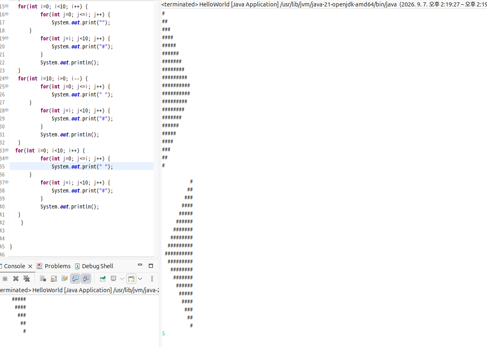

</details>

<details>
	<summary>
		### Homework 2
		</summary>
	
```java
public class pivo {
	public static void main(String []args){
	int a = 1, b = 1, c;
		System.out.print("1 1 ");

		for(int i=0; i<18; i++) {
			c = a + b;
			System.out.print(c+" ");
			a = b;
			b = c;
		}  
	}	
}
```
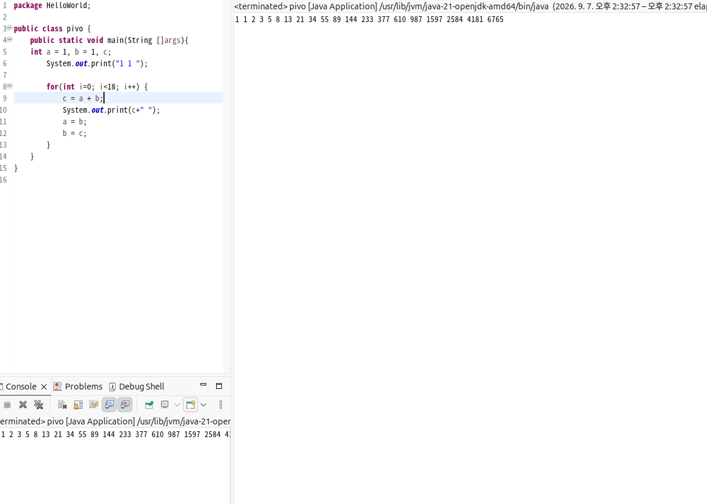

</details>

<details>
	<summary>	
	### Homework 3
		</summary>

```java
public class golden_ratio{
	public static void main(String []args) {
		double a=1 ,b=1, ratio;
		
		for(int i =0;i<20;i++)
		{
			ratio = a+b;
			System.out.printf("%.8f \n", ratio/a);
			b=a;
			a=ratio;
		}
	}
	
}
```
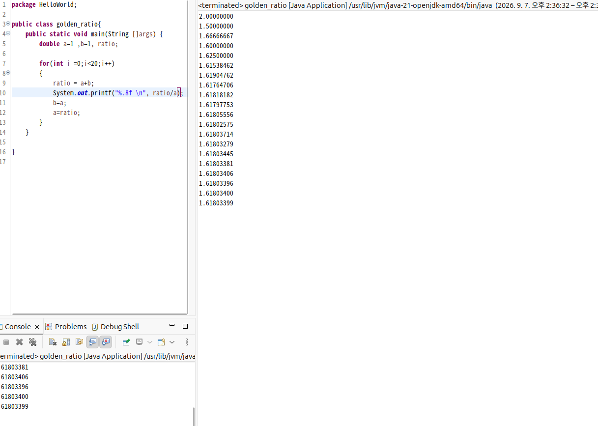
</details>

<details>
	<summary>
		### Homework 4
		</summary>

```java
public class multiplication_table {
	public static void main(String []args) {
		for(int i=1;i<10;i++) {
			for(int j=1;j<10;j++) {
				System.out.printf("%d*%d=%d ",j,i,j*i);
			}
			System.out.println();
		}
	}
}
```

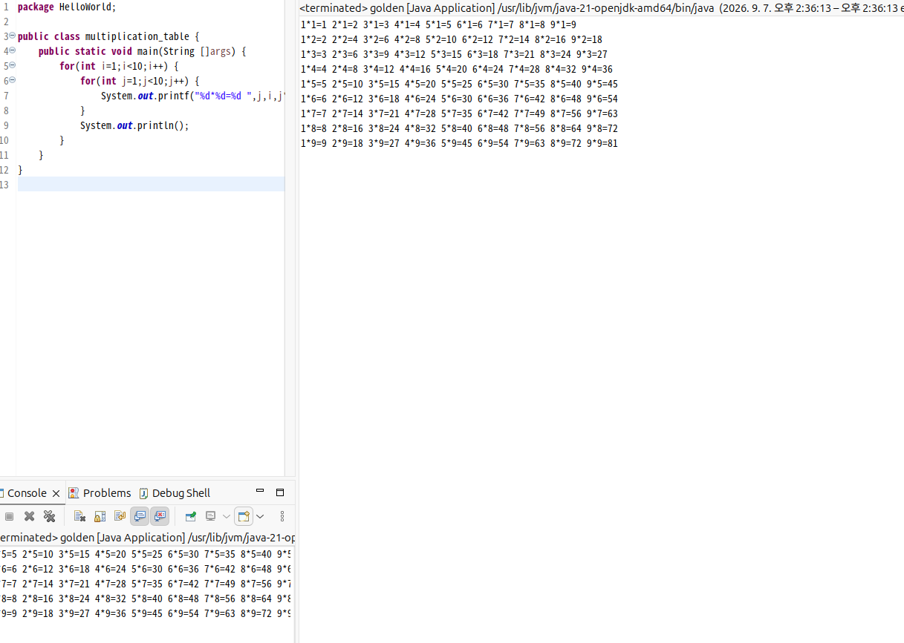

</details>
</details>

<details>
	<summary> 
		
## week2
</summary>
<details>
	<summary>
		### Homework 5
	</summary>


```java
public class Pi_calc {

	   public static void main(String[] args)
	  {
	    double pi = 0;      

	    for(int i = 10_000; i <= 100_000; i += 10_000)
	    {
	        double variablePart = 0;
	        for(int j = 1; j <= i; j++)
	        {
	            variablePart += (Math.pow(-1, j+1) / ((2 * j) - 1));
	        }
	        pi = 4 * variablePart;
	        System.out.printf("For i = %d\npi = %12.9f\n", i,pi);
	    }
	    System.out.println();
	    pi=0;
	    for(int j=0;j<1000;j++) {
	    	pi+=Math.pow(-3, -j)/(2*j+1);
	    }
	    pi*=Math.sqrt(12);
	    System.out.println("pi ="+pi);
	    
	  }
```

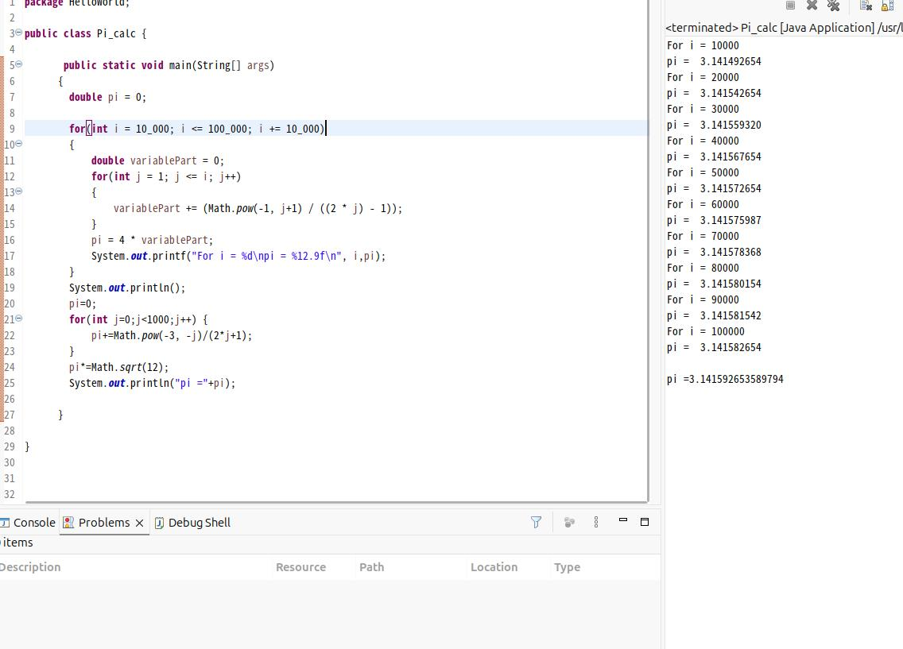

</details>

<details>
	<summary>
		### Homework 6
	</summary>

```java
public class BinomialCoefficients {

	public static void main(String []args) {
		int n = 7;
		int arr[][] = new int[n][n];
		
		for(int i=0;i<n;i++) {
			for(int j=0;j<=i;j++) {

				if(j==0||j==i)
					arr[i][j] = 1;
				else
				arr[i][j] = arr[i-1][j-1]+arr[i-1][j];
				System.out.print(arr[i][j]+" ");
			}
			System.out.println();
	}	
}
}
```

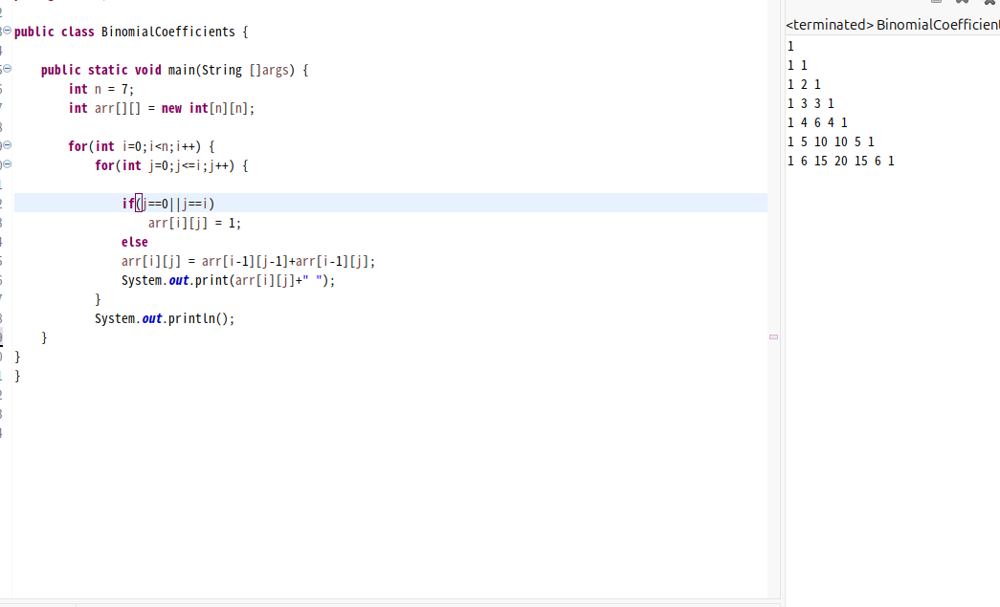
</details>

<details>
	<summary>
		### Homework 7
	</summary>


```java
public class Soting_al {
	public static void main (String[] args) {
		int data[] = new int[20];
		for(int i=0; i<20; i++)
		    data[i]=(int)(Math.random()*100);
		for(int i=0; i<20; i++)
		    System.out.println(data[i]);
		System.out.println();
		
		for(int i=0; i<20; i++) {
			int a=data[i];
			if(i>0) {
				for(int j=0;j<20;j++) {
					if(a>data[j]) {
						a=data[j];
						data[j]=data[i];
						data[i]=a;			
					}
				}
			
			}
		}
		for(int i=0; i<20; i++)
		    System.out.println(data[i]);
	}
```

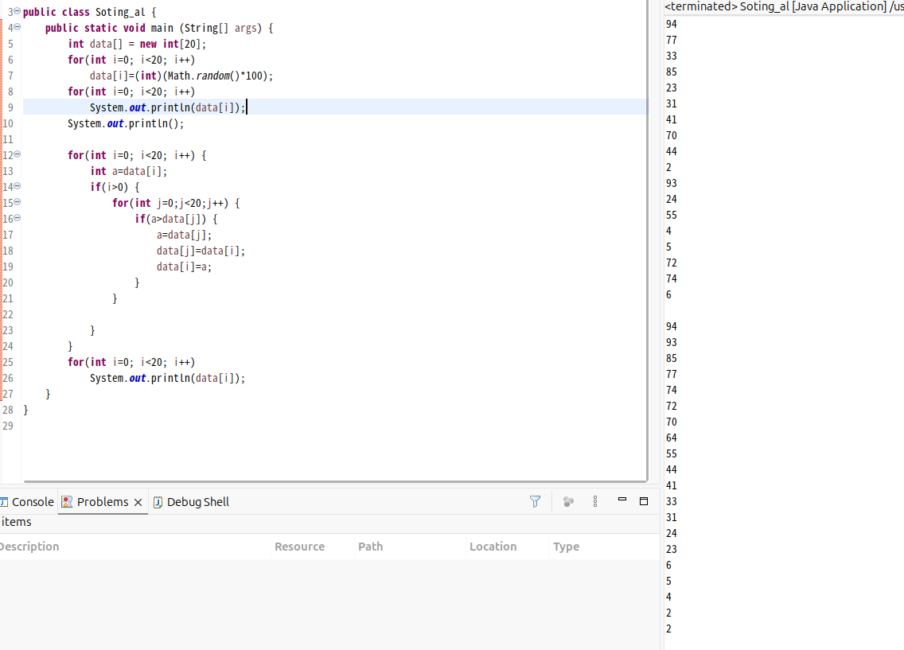

</details>

<details>
	<summary>
		### Homework 8
	</summary>


```java
public class Report_card {
	public static void main(String []args){
	int score[][] = new int[30][6];
	
	for (int i=0;i<30;i++) {
		int sum=0;
		for(int j=0;j<6;j++) {
			
			if(j<1)
				score[i][j]= i+1;
			else if(j<5) {
				score[i][j]=(int)(Math.random()*100);
			}
			else if(j<6) {
				for(int k=1;k<5;k++)
					sum += score[i][k];
				score[i][j]=sum;
			}
			System.out.printf("%d ",score[i][j]);

		}
		System.out.println();

	}
	}
}
```

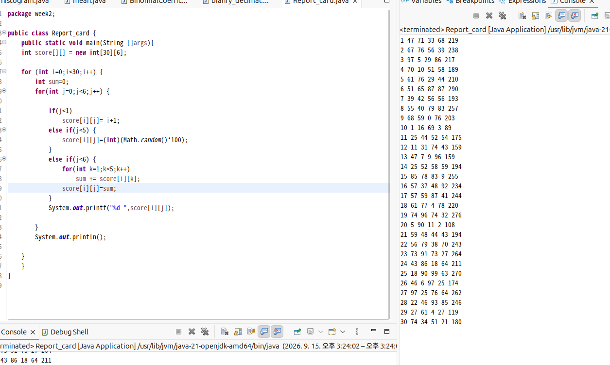

</details>
</details>

<details>
	<summary> 
		
## week 3
</summary>
<details>
	<summary>
		### Homework 9
	</summary>
	
```java
public class bianry_decimal {
	public static void main(String []args){
		int a=(int)(Math.random()*100);

		System.out.println(a);		
		ba(a);
		
	}
static void ba(int a) {
	if (a<=0)
		return;
	else {
		ba(a/2);
		System.out.printf("%d",a%2);
		}
	}
}
```

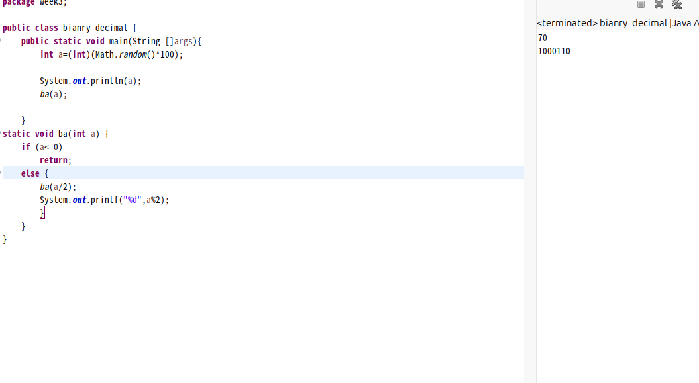	
</details>

<details>
	<summary>
	### Homework 10
	</summary>

```java
public class histogram {
	public static void main(String []args){
		int his[]= new int[100];
		int cnt=0,sum[]=new int[10],k=0;
		while (k<10) {
			for(int j=0;j<100;j++)
			{
				his[j]=(int)(Math.random()*100);
				//System.out.println(his[i]);
				cnt+=1;
				if(cnt%9==0) {
					for(int n=j;n>j-10;n--) {
						sum[k]+=his[j];	
					}	
			}
		}
			sum[k]/=100;
			//System.out.println(sum[k]);
			k++;		
		}
		k=0;
		while (k<10) {
			System.out.printf("%d ~ %d ",k*10,k*10+9);
			for(int i=0;i<sum[k];i++) {
				System.out.print("#");
			}
			System.out.println();
			k++;
		}	
	}
}
```

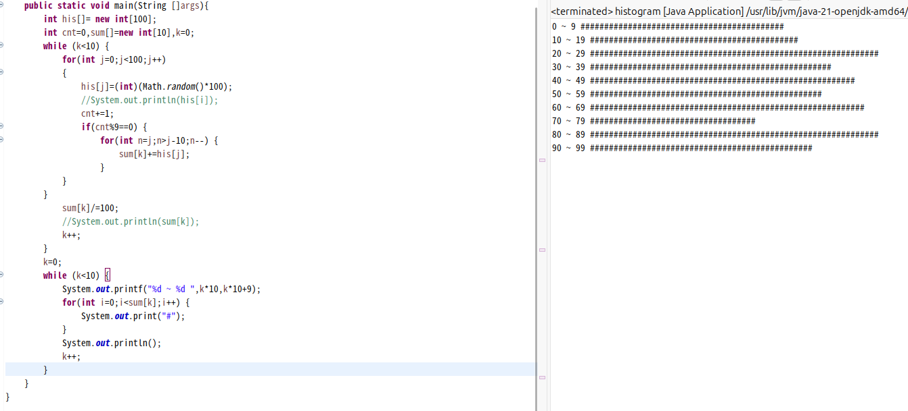	
</details>


<details>
	<summary>
		### Homework 11
	</summary>
	
```java
public class mean {
	public static void main(String[] args) {
		int n = 10;
		double ari, geo, har, sum1 = 0, sum2 = 1, sum3 = 0;
		int num[] = new int[n];
		
		for (int i = 0; i < n; i++) {
			num[i] = (int) (Math.random() * n);
			sum1 += num[i];
			sum2 *= num[i];
			sum3 += 1.0 / num[i];
		}
		ari = sum1 / n;
		geo = Math.pow(sum2, 1.0 / n);
		har = n / sum3;
		for (int i = 0; i < n; i++) {
			int a = num[i];
			if (i > 0) {
				for (int j = 0; j < n; j++) {
					if (a > num[j]) {
						a = num[j];
						num[j] = num[i];
						num[i] = a;
					}
				}

			}
		}
		if (n%2==0) {
			mid1=num[(n/2)-1];
			mid2=num[n/2];
			mid = (mid1+mid2)/2.0;
		}	
		else
			mid = num[n/2];
		System.out.printf("ari : %f\ngeo : %f\nhar : %f\nmid : %f\n", ari, geo, har,mid);
		//for (int i = 0; i < n; i++)
		//	System.out.print(num[i] + " ");
	}
}

```

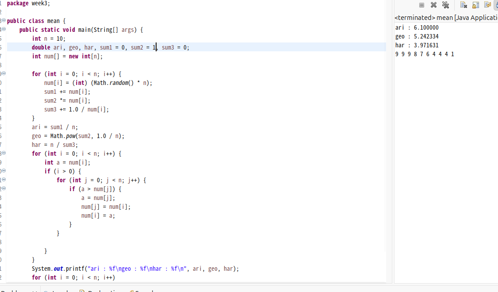	
</details>


<details>
	<summary>
		### Homework 12
	</summary>
	
```java
	not codig
```

	

</details>
</details>
<details>
	<summary>
		
## week 4
</summary>
<details>
	<summary>
		### Homework 13
	</summary>
	
```java
import java.util.Scanner;
public class calc {
  public static void main(String[] args) {
	  int result;
    while(true) {
      Scanner scanner = new Scanner(System.in);
      String inputString = scanner.nextLine();
      System.out.println(inputString);
      String[] arrOfStr = inputString.split(" "); 
      for (String a : arrOfStr) 
        System.out.println(a);
      if(arrOfStr[1].equals("+")) { 
    	  result = Integer.parseInt(arrOfStr[0])+Integer.parseInt(arrOfStr[2]);
      	System.out.println(result);
      	}
      if(arrOfStr[1].equals("-")) { 
    	  result = Integer.parseInt(arrOfStr[0])-Integer.parseInt(arrOfStr[2]);
    	System.out.println(result);
    	}
      if(arrOfStr[1].equals("*")) { 
    	  result = Integer.parseInt(arrOfStr[0])*Integer.parseInt(arrOfStr[2]);
      	System.out.println(result);
      	}
      if(arrOfStr[1].equals("/")) { 
    	  result = Integer.parseInt(arrOfStr[0])/Integer.parseInt(arrOfStr[2]);
      	System.out.println(result);
      	}
  }
}
}
```

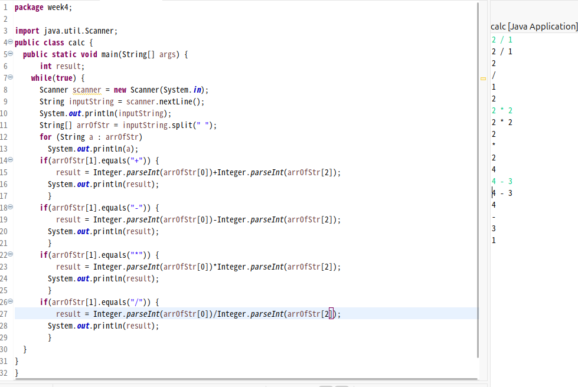	
</details>

<details>
	<summary>
	### Homework 14
	</summary>

	
<details>
	<summary>
		class
	</summary>
	
```java
public class Num {
	int num[];
	Num(int num[]) {
		this.num = num;
	}
	double getTotal(int n) {
		double sum1=0,sum2=1,sum3=0;
		for(int i=0; i<num.length; i++) {
			sum1+=num[i];
			sum2*=num[i];
			sum3+=1.0/num[i];
		}
		if(n==1)
			return sum1;
		else if(n==2)
			return sum2;
		else
			return sum3;
	}
	double getArithmaticMean() {
		return getTotal(1)/num.length;
	}
	double getHarmonicMean() {
		return Math.pow(getTotal(2),1.0/num.length);
	}
	double getGeometricMean() {
		return num.length/getTotal(3);
	}	
	int getMedian() {
		//sorting();
		int mid1,mid2;
		if (num.length%2==0) {
			mid1=num[(num.length/2)-1];
			mid2=num[num.length/2];
			return (mid1+mid2)/2;
		}	
		else
			return num[num.length/2];
		
	}
	void sorting() {
		for (int i = 0; i < num.length - 1; i++) {
		    for (int j = i + 1; j < num.length; j++) {
		        if (num[i] > num[j]) {
		            int a = num[i];
		            num[i] = num[j];
		            num[j] = a;
		        }
		    }
		}
	}
	void drawHistogram(int start, int end, int binCount, int scale) {
	    //sorting();

	    int[] sum = new int[binCount];
	    int width = (end - start) / scale;

	    for (int i = 0; i < num.length; i++) {
	        if (num[i] >= start && num[i] <= end) {
	            int k = (num[i] - start) / width;

	            if (k == binCount) {
	                k--;
	            }

	            sum[k]++;
	        }
	    }

	    for (int k = 0; k < binCount; k++) {
	        int binStart = start + k * width;
	        int binEnd = binStart + width;

	        System.out.printf("%2d~%2d : ", binStart, binEnd);

	        for (int j = 0; j < sum[k] * scale; j++) {
	            System.out.print("#");
	        }
	        System.out.println();
	        //System.out.println(" (" + sum[k] + ")");
	    }
	}
	void display() {
		sorting();
		System.out.printf("%3d :", num.length);		
		for(int i=0; i<num.length; i++) System.out.printf("%3d ", num[i]);
		System.out.println();

	}
}

```
</details>

<details>
	<summary>
		use
	</summary>
		
```java
public class numtest {
	public static void main(String[] args) {
		int size=100;
		int data[]=new int[size];
		for(int i=0; i<size; i++) data[i]=(int)(Math.random()*100);
		Num obj = new Num(data);
		obj.display();
		System.out.printf("Arithmetic Mean : %5.2f\n", obj.getArithmaticMean());
		System.out.printf("Geometric Mean : %5.2f\n", obj.getGeometricMean());		
		System.out.printf("Harmonic Mean : %5.2f\n", obj.getHarmonicMean());	
		System.out.printf("Median Mean : %d\n", obj.getMedian());	
		obj.drawHistogram(0,100,10,10);// min, max, bin_size, display_scale;
	}
}
```
</details>
			
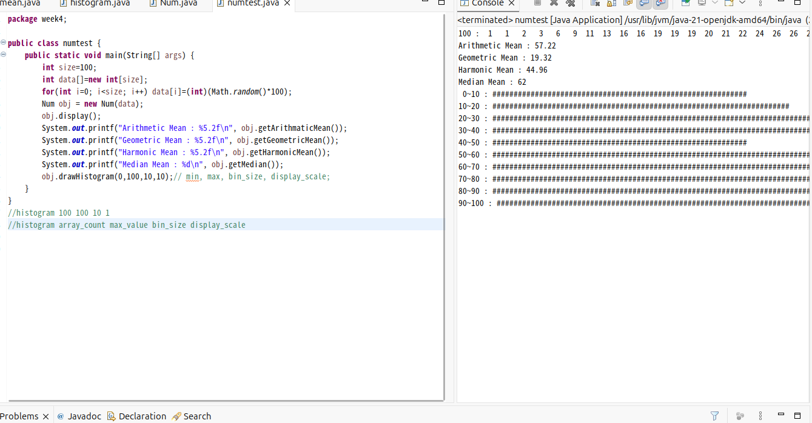	
</details>


<details>
	<summary>
		### Homework 15
	</summary>
	
```java

```

	
</details>


<details>
	<summary>
		### Homework 16
	</summary>
	
```java

```

	

</details>
</details>
